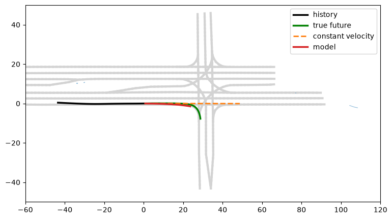

# motion-forecasting

Predict where a car will be over the next 6 seconds from 5 seconds of history, the surrounding agents, and the lane map. Built from scratch on [Argoverse 2 Motion Forecasting](https://www.argoverse.org/av2.html), on a single consumer GPU.



## Results

Held-out test set, 951 scenarios. Errors are in meters; FDE is the distance between the predicted and true position at the 6 s mark, ADE is the average distance over all 60 steps.

| Model | ADE (median) | FDE (median) | FDE (p95) | FDE on turns (median, n=133) |
|---|---|---|---|---|
| Constant velocity | 3.39 | 8.65 | 30.36 | 22.76 |
| History-only MLP (215k params) | 2.39 | 5.84 | 24.00 | not yet measured |
| Scene model: agents + lanes, attention (862k params) | 2.16 | 5.37 | 21.17 | 11.91 |

"Turns" means the true future drifts more than 10 m sideways, so it also includes lane changes. Both learned models predict a residual on top of constant velocity.

The history-only network removes about a third of the baseline's median error. The scene model removes a bit more (about 8% beyond history-only on median FDE); a significance test and ablations are still to do.

## Approach

1. **Agent frame.** Every scene is translated and rotated so the target car is at (0, 0) facing +x at the last observed step. The network never sees global coordinates.
2. **Vector tokens.** Lanes are cut into chunks of 8 centerline vectors (about 15 m); each agent is its 50-step history. Per-vector MLP, masked max-pool, then masked self-attention over all agent and lane tokens.
3. **Residual head.** Prediction = constant-velocity path + learned residual, with the last layer zero-initialised. An untrained model therefore equals the baseline exactly, which is used as a pipeline test.
4. **Loss:** ADE.

Details and everything learned along the way are in [FINDINGS.md](FINDINGS.md).

## Reproduce

```bash
# 1. download a slice of the data (public S3, no account needed)
s5cmd --no-sign-request cp "s3://argoverse/datasets/av2/motion-forecasting/train/00*" data_dir/

# 2. convert scenarios to compact per-scenario .npz files (build_scenario in src/data.py)
# 3. history-only baseline
python train.py --data_dir path/to/processed
```

## Caveats

- The split is random by scenario over the train and val folders combined, not the official split. Scenes from the same drive may appear on both sides.
- Scene model vs history-only MLP: the gap is small and has not yet been tested for significance.
- Single predicted path only. Turns are still the weak spot; predicting several futures is next.

## Next

Paired bootstrap on scene vs history-only, ablations (agents only / lanes only), multi-modal output with a min-over-K loss, more data.
